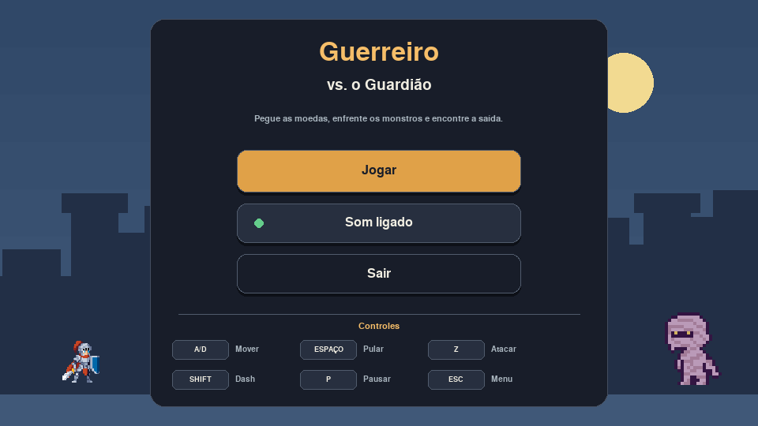

# Guerreiro Vs O Guardião

Jogo de plataforma medieval 2D criado em Python com Pygame Zero para o teste
prático de tutoria da Kodland.



## História

Um guerreiro precisa atravessar o vilarejo de Arven, as muralhas de Eldoria e
a cripta onde o Selo das Sombras foi rompido. Em cada fase, ele deve recolher
todas as moedas e derrotar os inimigos para abrir a porta de saída.

## Como executar

Requer Python 3 e Pygame Zero.

```bash
python3 -m pip install -r requirements.txt
./run_game.sh
```

O iniciador posiciona a janela no centro da tela e evita a janela temporária
de 100 x 100 criada pelo comando `pgzrun`. No Windows, execute `run_game.bat`.
Para garantir a centralização, sempre use um desses dois iniciadores.

## Controles

- `A`/`D` ou setas: movimentar
- `W`, seta para cima ou `Espaço`: pular
- `Z` ou `X`: atacar com a espada
- `Shift` ou `C`: executar um dash
- `P`: pausar ou continuar
- `Esc`: voltar ao menu
- `R`: reiniciar depois da vitória ou derrota

## Recursos implementados

- Três fases com objetivos, pontuação e dificuldade progressiva
- Menu com botões clicáveis e guia compacto de teclas
- Controle conjunto de música e efeitos sonoros
- Cavaleiro em pixel art com animações de espera, corrida, pulo, queda, dano e
  ataque
- Plataformas sólidas, com colisão por cima, por baixo e pelas laterais
- Movimento mais suave, salto, dash com recarga e efeito visual
- Aranhas, morcegos e múmias com animações de espera e movimento
- Morcegos com voo baixo e patrulha simples para facilitar o combate
- Poções de cura, pontuação e porta com objetivo duplo
- Guardião final com barra de vida e sete pontos de resistência
- HUD, tela de pausa e mensagens de objetivo
- Classes próprias para personagens, movimento e animação

## Organização do código

- `AnimatedCharacter`: troca os quadros das animações.
- `Hero`: controla movimento, colisões, ataque e vidas.
- `Enemy`: controla patrulha, dano e animações dos inimigos.
- `LEVELS`: guarda plataformas, moedas, inimigos e saída de cada fase.

Consulte [CREDITS.md](CREDITS.md) para as licenças dos recursos visuais e
sonoros utilizados.
